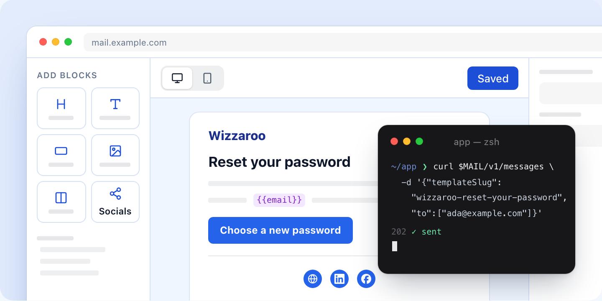
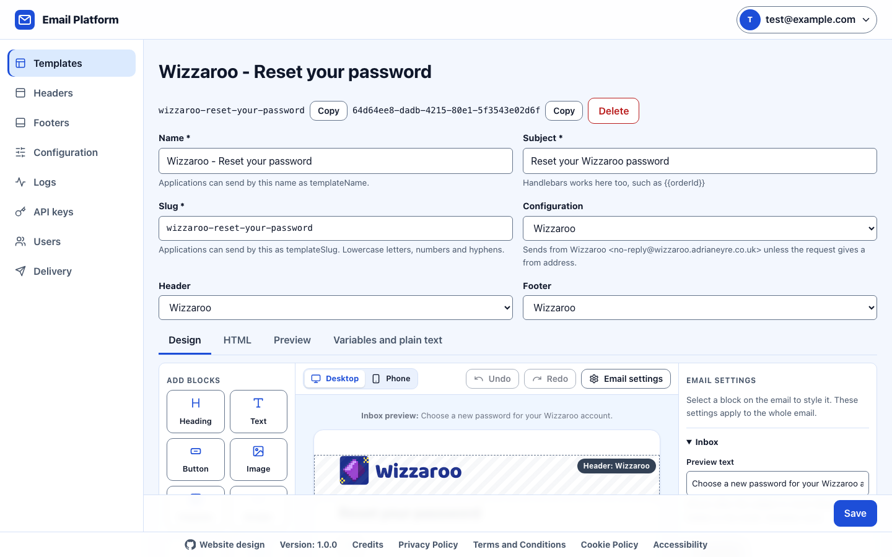
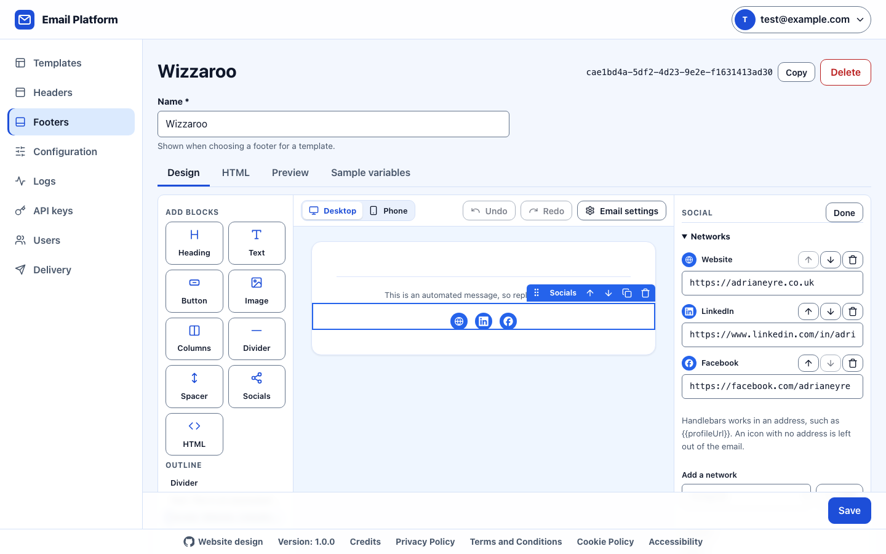
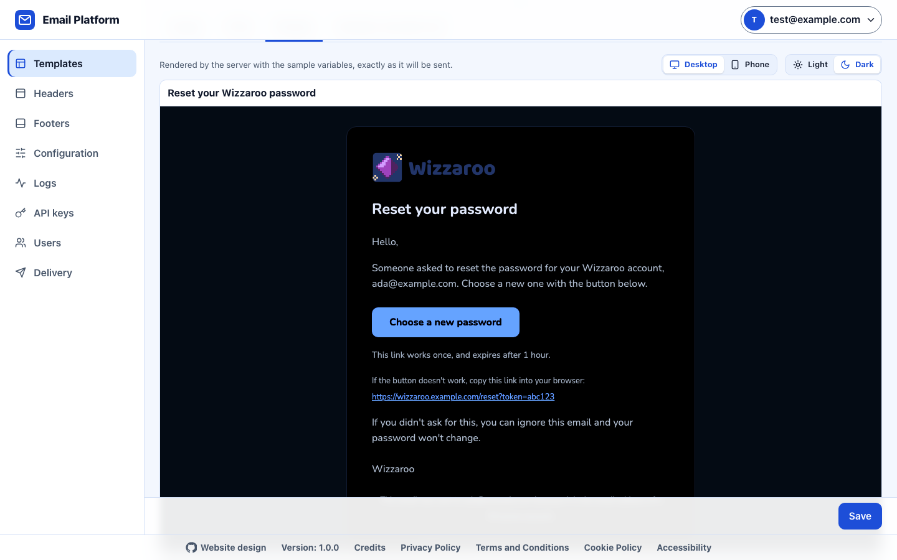
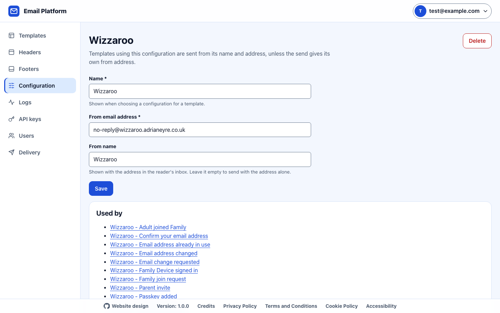
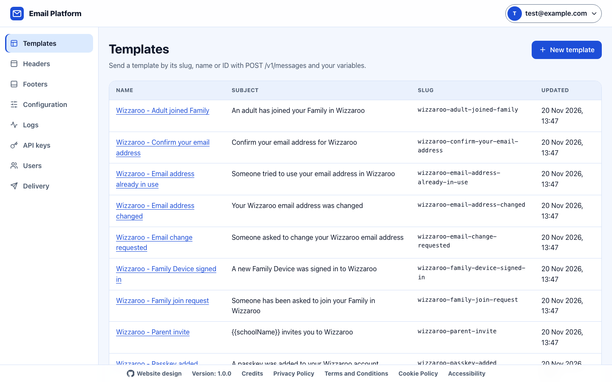
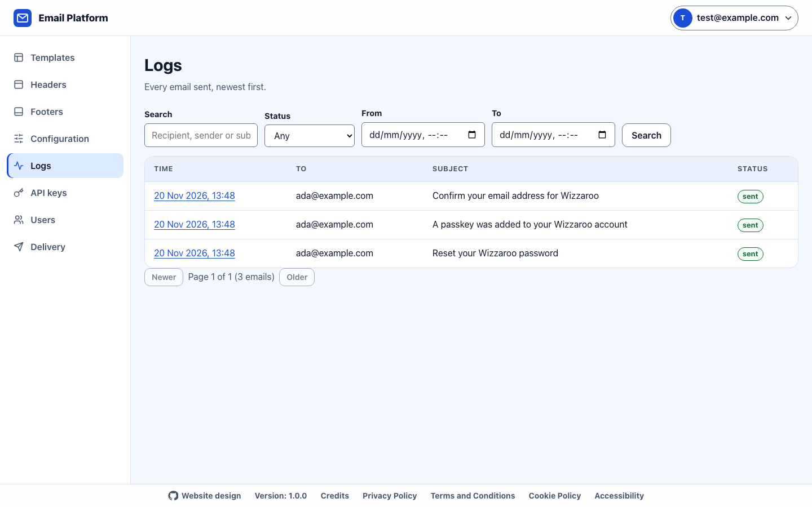
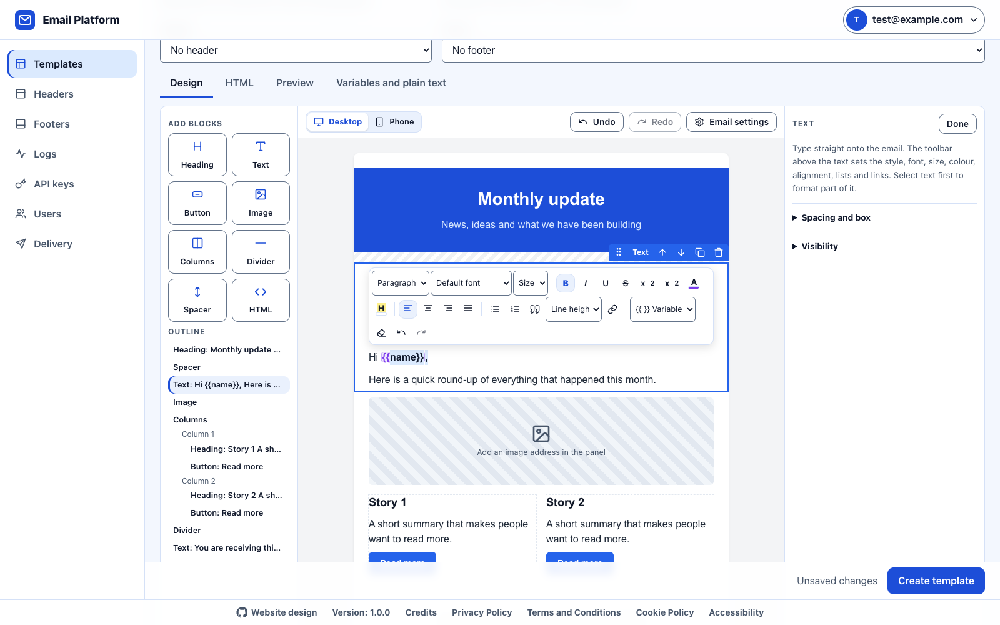
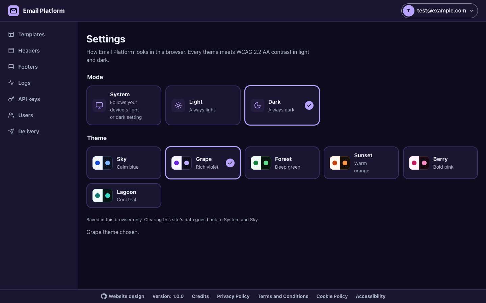

<div align="center">

# Email Platform

**Design email templates. Send them from your apps with one call.**

[Website](https://email-platform.adrianeyre.co.uk/) · [Documentation](docs/README.md) · [Changelog](CHANGELOG.md) · [Releases](https://github.com/adrianeyre/email-platform/releases)

<picture>
  <source media="(prefers-color-scheme: dark)" srcset="docs/images/illustrations/hero-dark.png" />
  
</picture>

</div>

A small self-hosted app that keeps your **email templates** and **sends your emails**. Build each template in a visual designer, share a header and footer between them, then let your applications send one by its slug (such as `wizzaroo-reset-your-password`) with a single REST call. The app renders the email, sends it through its own Postfix mail server, or through any SMTP provider you choose instead (Amazon SES SMTP, Postmark, Fastmail, Gmail or any other), and logs every email.

Email leaves through the Postfix server in the same Compose stack, DKIM-signed, so a new install sends with nothing to set up beyond DNS records ([Sending with Postfix](docs/operations/sending-with-postfix.md)). Everything else lives in the app's own Postgres, which runs in Docker: users, API keys, templates, headers and footers, configurations, Delivery settings and the send log.

## Features

| Area                | What it does                                                                                                                                                                                                   | Guide                                                      |
| ------------------- | -------------------------------------------------------------------------------------------------------------------------------------------------------------------------------------------------------------- | ---------------------------------------------------------- |
| Templates           | A visual designer with text, buttons, images, columns, dividers, spacers, socials and HTML blocks, full text formatting and undo; or HTML by hand. Handlebars `{{variables}}`, checked when sending            | [Templates](docs/guide/templates.md)                       |
| Socials             | Linked icons for 27 social networks, a website and an email address, built in as SVG and written into the email, in any shape and colour                                                                       | [Socials](docs/guide/templates.md#socials)                 |
| Previews            | Desktop and phone widths, in **Light** or **Dark** to see how mail apps that darken emails will show yours, plus test sends                                                                                    | [Templates](docs/guide/templates.md#the-other-tabs)        |
| Slugs               | A unique, editable name your code can keep: lowercase letters, numbers and hyphens, made from the template's name                                                                                              | [Slugs](docs/guide/templates.md#slugs)                     |
| Headers and footers | Shared content above and below templates, such as a logo or legal notes, edited once in the same designer; every template using one sends with its latest version                                              | [Templates](docs/guide/templates.md#headers-and-footers)   |
| Configuration       | Settings shared by templates: the from name and address they are sent with, such as `Wizzaroo <no-reply@wizzaroo.adrianeyre.co.uk>`                                                                            | [Configuration](docs/guide/templates.md#configuration)     |
| Built-in emails     | 15 ready-made Wizzaroo emails (sign-ups, password resets, passkeys, invitations and account changes) with their header, footer and configuration, added in one command                                         | [Built-in emails](docs/guide/templates.md#built-in-emails) |
| Sending             | `POST /v1/messages` by template slug, name or ID, with to, cc, bcc, reply-to and attachments; queued and retried 3 times with backoff; `Idempotency-Key` support; a typed Node client                          | [Sending](docs/guide/sending.md)                           |
| Logs                | One row per email with its status, any error and the rendered email; searchable; deleted after the retention you choose                                                                                        | [Logs](docs/guide/logs.md)                                 |
| Delivery and access | Postfix built in as the SMTP provider, or any other (password encrypted), a default from address (`no-reply@adrianeyre.co.uk` to start), users with passwords and API keys for applications, all stored hashed | [Delivery and access](docs/guide/delivery-and-access.md)   |
| Interface           | Built to WCAG 2.2 AA, with System, Light or Dark and six colour themes, each tested for contrast; every tab titled `Email Template - …`                                                                        | [Accessibility](docs/guide/accessibility.md)               |

## Screenshots

<table>
  <tr>
    <td width="50%">
      <a href="docs/guide/templates.md#the-visual-designer"></a>
      <br /><b>A template</b>: its slug, configuration, header and footer, then the designer.
    </td>
    <td width="50%">
      <a href="docs/guide/templates.md#socials"></a>
      <br /><b>Socials</b>: networks, addresses and the look, in the designer.
    </td>
  </tr>
  <tr>
    <td width="50%">
      <a href="docs/guide/templates.md#the-other-tabs"></a>
      <br /><b>Preview</b> in Light or Dark, at desktop or phone width.
    </td>
    <td width="50%">
      <a href="docs/guide/templates.md#configuration"></a>
      <br /><b>Configuration</b>: one from address for a set of templates.
    </td>
  </tr>
  <tr>
    <td width="50%">
      <a href="docs/guide/templates.md"></a>
      <br /><b>Templates</b>, each with the slug apps send it by.
    </td>
    <td width="50%">
      <a href="docs/guide/logs.md"></a>
      <br /><b>Logs</b>: every email, its status and any error.
    </td>
  </tr>
  <tr>
    <td width="50%">
      <a href="docs/guide/templates.md#formatting-text"></a>
      <br /><b>Rich text</b> with fonts, sizes, colours and links.
    </td>
    <td width="50%">
      <a href="docs/guide/delivery-and-access.md#appearance"></a>
      <br /><b>Appearance</b>: System, Light or Dark, in six themes.
    </td>
  </tr>
</table>

## Quick start

You need Node.js 26, pnpm 12.21 and Docker.

```sh
pnpm install
docker compose -f docker-compose.dev.yml up -d   # Postgres, and Mailpit to catch email
cp .env.example .env
pnpm migrate
pnpm cli user:create you@example.com             # prompts for a password
pnpm cli templates:add-built-ins                 # the 15 Wizzaroo emails
pnpm exec vite build
pnpm local                                        # the api and worker together, on http://localhost:4320
```

Sign in, point **Delivery** at Mailpit (`localhost`, port `1025`), create an API key, and send. [Local setup](docs/getting-started/local-setup.md) walks through every step and lists every command.

## Send an email

By slug, with curl:

```sh
curl -X POST http://localhost:4320/v1/messages \
  -H "Authorization: Bearer ek_…" -H "Content-Type: application/json" \
  -d '{"to":["ada@example.com"],
       "templateSlug":"wizzaroo-reset-your-password",
       "variables":{"email":"ada@example.com","resetUrl":"https://app.example.com/reset?t=abc","linkLifetime":"1 hour"}}'
```

Or with the typed Node client, [`@adrianeyre/email-client`](packages/email-client/README.md), which checks each built-in email's variables when you compile. It is published to [GitHub Packages](https://github.com/adrianeyre/email-platform/pkgs/npm/email-client), so point the `@adrianeyre` scope there in an `.npmrc` beside your app's `package.json`, with a GitHub token that has the `read:packages` scope:

```ini
@adrianeyre:registry=https://npm.pkg.github.com
//npm.pkg.github.com/:_authToken=${GITHUB_TOKEN}
```

```sh
pnpm add @adrianeyre/email-client
```

```ts
import { createEmailClient } from "@adrianeyre/email-client";

const email = createEmailClient({
  baseUrl: "https://mail.example.com",
  apiKey: process.env.EMAIL_API_KEY,
});
await email.builtIn.resetYourPassword({
  to: "ada@example.com",
  variables: { email: "ada@example.com", resetUrl, linkLifetime: "1 hour" },
});
```

The email is sent from the template's configuration (here `Wizzaroo <no-reply@wizzaroo.adrianeyre.co.uk>`) unless the request gives a `from`. Every field, and what happens after `202`, is in [Sending](docs/guide/sending.md).

## Documentation

| Read                                                                    | For                                                                                    |
| ----------------------------------------------------------------------- | -------------------------------------------------------------------------------------- |
| [Local setup](docs/getting-started/local-setup.md)                      | Running it, your first email, sending from Node, and every command                     |
| [Environment variables](docs/reference/environment-variables.md)        | `DATABASE_URL`, `PORT`, `APP_URL` and `ENCRYPTION_KEY`                                 |
| [Templates](docs/guide/templates.md)                                    | The designer, Socials, previews, slugs, headers, footers, configurations and built-ins |
| [Sending](docs/guide/sending.md)                                        | `POST /v1/messages`, the from address and idempotency                                  |
| [Logs](docs/guide/logs.md)                                              | The send log and retention                                                             |
| [Delivery and access](docs/guide/delivery-and-access.md)                | The SMTP provider, default from address, users, API keys, appearance                   |
| [Accessibility](docs/guide/accessibility.md)                            | WCAG 2.2 AA and how it is checked                                                      |
| [How it fits together](docs/architecture/how-it-fits-together.md)       | The four roles and the life of an email                                                |
| [Deploying](docs/operations/deploying.md)                               | First-time setup and `pnpm deploy:server`                                              |
| [Sending with Postfix](docs/operations/sending-with-postfix.md)         | The built-in SMTP provider and its DNS records                                         |
| [Backups and restore](docs/operations/backups-and-restore.md)           | Nightly encrypted backups and restoring one                                            |
| [Website, CI and releases](docs/operations/website-ci-and-releases.md)  | The website and its Stageshow illustrations, releases, the client                      |
| [Search engines and icons](docs/operations/search-engines-and-icons.md) | SEO and device icons                                                                   |

All of it is indexed in [docs/README.md](docs/README.md). See [CONTRIBUTING.md](CONTRIBUTING.md) to work on the code, [GLOSSARY.md](GLOSSARY.md) for the terms used, and [the architectural decision records](docs/architectural-decision-record/) for why it is built this way.
