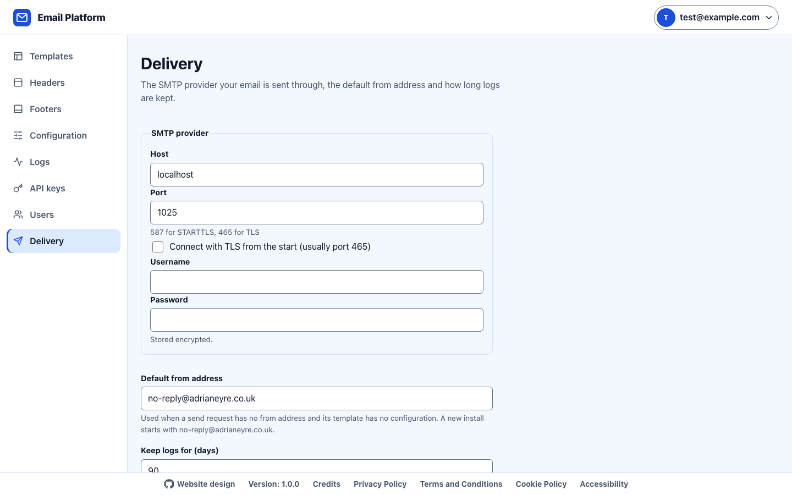

# Delivery and access

## Delivery

**Delivery** in the side menu holds how email leaves the app. It is stored in Postgres, so nothing here is an environment variable.

- **SMTP provider:** one host, port, TLS setting, username and password, such as Amazon SES SMTP, Postmark, Fastmail or Gmail ([ADR 0002](../architectural-decision-record/0002-live-delivery-relays-through-an-upstream-provider.md)). Use port 587 for STARTTLS or 465 for TLS from the start. The password is encrypted with AES-256-GCM using `ENCRYPTION_KEY`, and is never shown again; leave it blank to keep the saved one. For local development, point it at Mailpit: host `localhost`, port `1025`, no TLS and no username.
- **Default from address:** used when a send request has no `from` and its template has no [configuration](templates.md#configuration). A new install starts with `no-reply@adrianeyre.co.uk`. Clear it and such sends are refused, so every send must then name its sender. The full order is in [The from address](sending.md#the-from-address).
- **Keep logs for (days):** how long the [log](logs.md) keeps each email, 90 days to start with.
- **Send a test email:** sends a plain message to an address you give, through the saved provider, so you can check it works.

## Access

- **Users** sign in to the UI with an email address and a password of at least 12 characters, stored as a salted scrypt hash. A session lasts 30 days in an `HttpOnly` cookie, `Secure` when `APP_URL` is `https://`. Everyone listed under **Users** can manage everything.
  - **Add user** opens a dialog for their email and password. **Generate a strong password** makes a random 20-character one, without look-alike characters, to copy and share privately. Or run `pnpm cli user:create <email>`.
  - **Change your password** asks for your current one, then the new one twice, ticking off each rule (12 or more characters, different from the current one, repeated the same) as you type. You stay signed in.
  - **Remove** signs that person out everywhere at once. You can't remove yourself.
- **API keys** are how applications send. Each is a Bearer token starting `ek_`, shown once when it is created under **API keys** or with `pnpm cli apikey:create <name>`, and stored only as a SHA-256 hash. Delete a key to stop an application sending with it.

## Deleting things

Every **Delete** (and **Remove**) button opens a dialog before anything is deleted. It names what will go, with its details (such as a template's slug and ID, or an API key's prefix and when it was last used), lists what deleting it changes (such as the templates a footer or configuration is used by, or that applications using a key are refused with `401`), and says it can't be undone. **Cancel**, Esc or the close button leave everything as it was.

## Appearance

**Settings**, in the account menu at the top right, chooses System, Light or Dark and one of six colour themes (Sky, Grape, Forest, Sunset, Berry and Lagoon). The choice is kept in the browser. Every theme meets WCAG 2.2 AA contrast in light and dark; see [Accessibility](accessibility.md).
