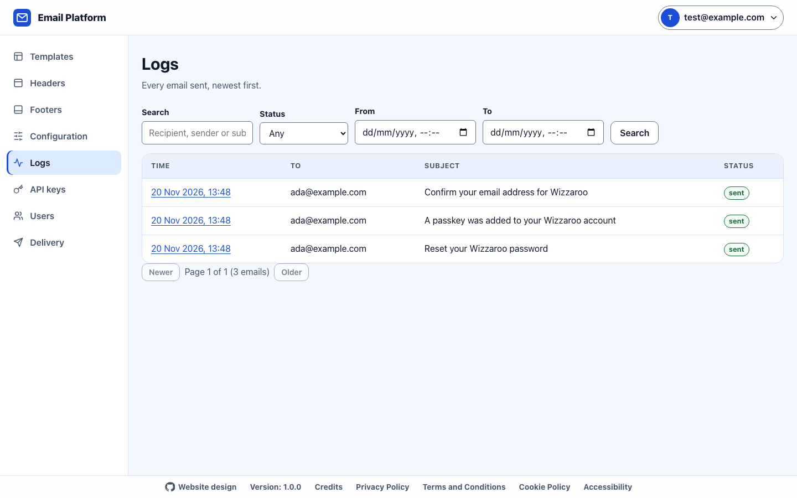

# Logs

Every email the app is asked to send is one row in **Logs**, newest first. Each row records:

- when it was queued and sent;
- its from address, recipients (to, cc, bcc) and reply-to;
- its rendered subject, HTML and text;
- its status: `queued`, `sent` or `failed`;
- the number of attempts, the provider's message ID and the last error;
- the template it came from, if any.

Search by recipient, sender or subject, filter by status, and narrow to a time range. Open a row to see the email as it was sent, together with any error.

## Retention

A daily job (03:30 UTC) deletes emails older than **Keep logs for (days)** on the Delivery page. The default is 90 days.
