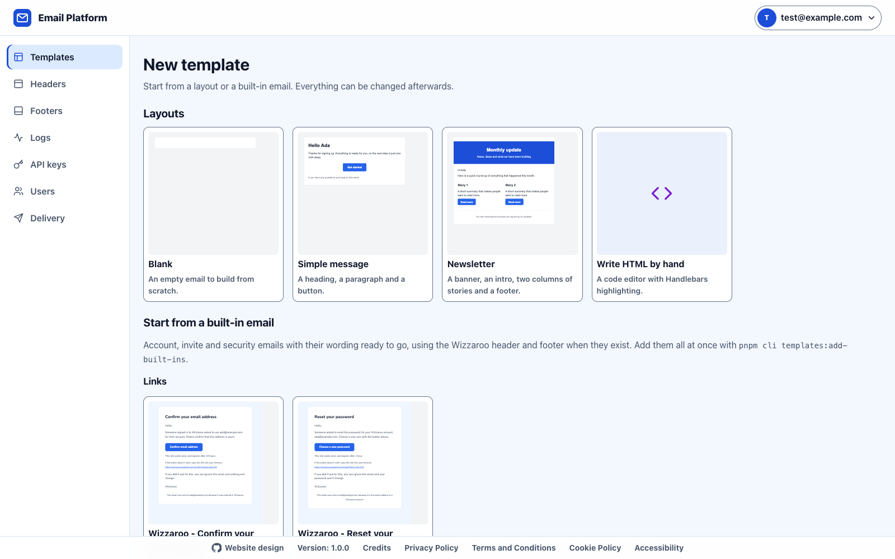
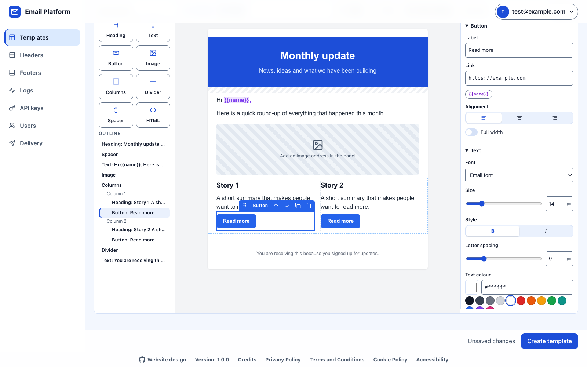
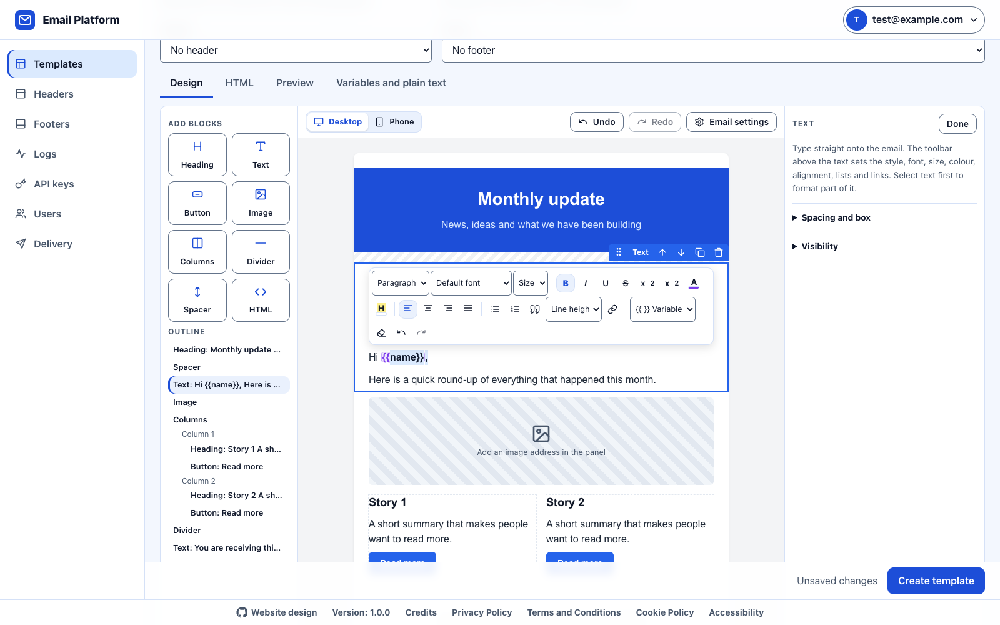
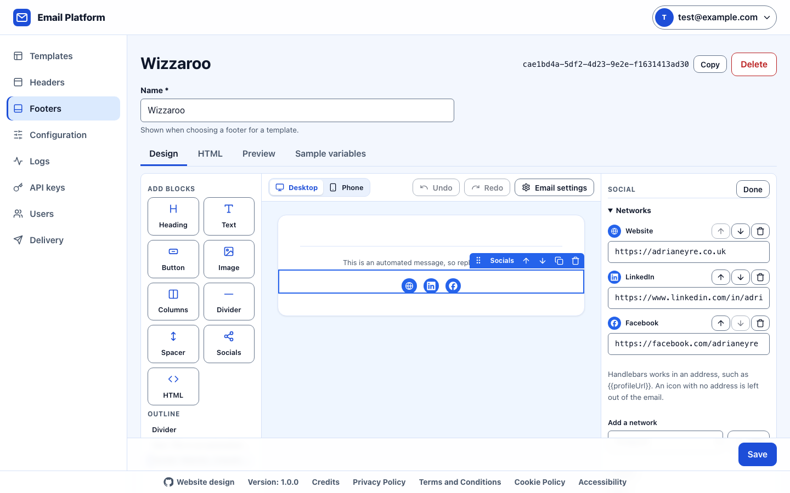
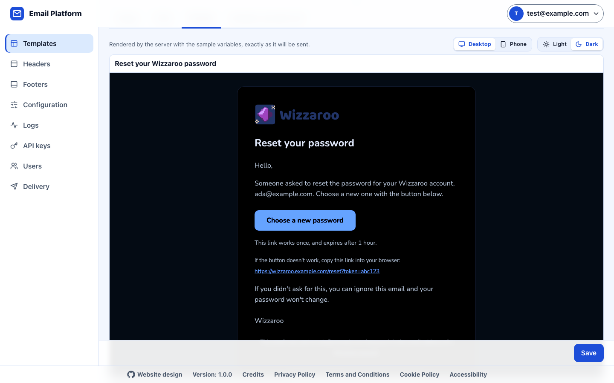
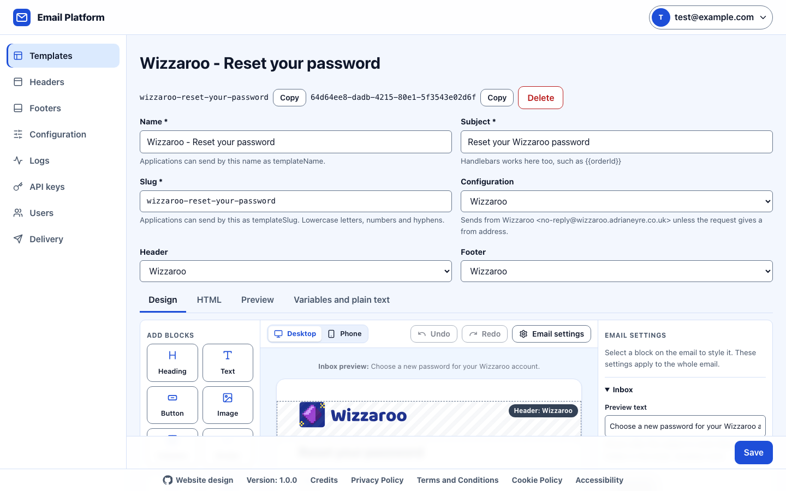
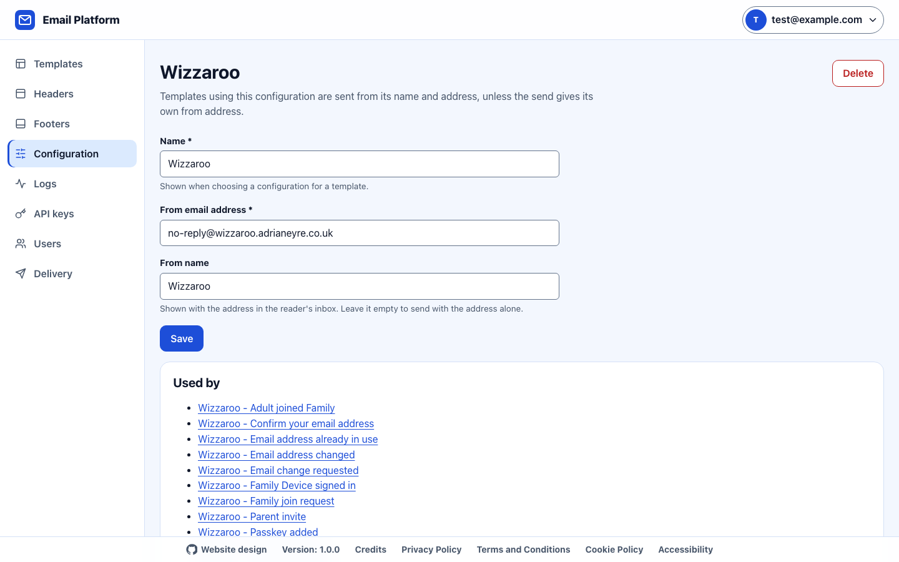
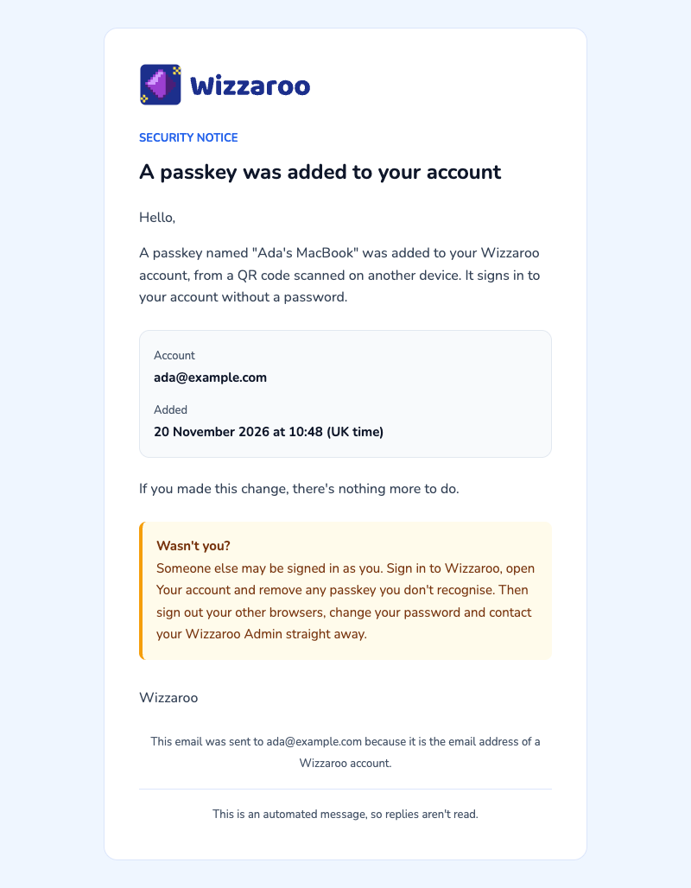

# Templates

A template has a **name**, a **slug**, a **subject**, an **HTML body**, an optional **text body**, and a list of **required variables**. All three parts are rendered with [Handlebars](https://handlebarsjs.com/guide/). Variables are HTML-escaped in the HTML body, and used as written in the subject and text body.

```handlebars
<h1>Hi {{name}}</h1>
{{#if trackingUrl}}<p><a href="{{trackingUrl}}">Track order
      {{orderId}}</a></p>{{/if}}
<ul>{{#each items}}<li>{{this.title}} × {{this.quantity}}</li>{{/each}}</ul>
```

When the text body is empty, it is generated from the rendered HTML. The hidden preheader is left out of it.

The HTML is made in one of two ways:

- **The visual designer** builds it from blocks. The template keeps its **design** (the blocks) beside the HTML, so it opens in the designer again.
- **By hand**, in a code editor with Handlebars highlighted.

Sending only ever uses the HTML. The design is there for the editor.

## Starting a template

**Templates → New template** opens a gallery:

- **Layouts:** Blank, Simple message (heading, text and button) and Newsletter (banner, columns and footer).
- **Write HTML by hand.**
- **Built-in emails:** the [built-in emails](#built-in-emails), grouped as Links, Invites, Security notices and Other notes.



## The visual designer

The **Design** tab has three panes.

**Blocks, on the left.** Drag a block onto the email, or click it to add it below the selected block. The **Outline** under the palette lists every block, including those inside columns. Click an entry to jump to that block.

| Block   | What it is                                                                                                                                                    |
| ------- | ------------------------------------------------------------------------------------------------------------------------------------------------------------- |
| Heading | A text block that starts as a large title                                                                                                                     |
| Text    | Rich text, typed straight onto the email                                                                                                                      |
| Button  | A link drawn as a button, with its own label, link, colours, font, size, bold and italic, letter spacing, rounding, border, padding, alignment and full width |
| Image   | A picture from a public URL, with alt text, an optional link, a width, alignment and rounding                                                                 |
| Columns | 2 to 4 columns with preset widths, a gap and vertical alignment. Each column holds its own blocks, and they stack on phones unless you turn that off          |
| Divider | A line with its own colour, thickness, style (solid, dashed or dotted), width and alignment                                                                   |
| Spacer  | Empty space of a set height                                                                                                                                   |
| Socials | Linked icons for 27 social networks, a website and an email address, with their shape, colour, size, spacing, alignment and names. See [Socials](#socials)    |
| HTML    | Your own HTML and Handlebars, shown in a frame that runs no scripts                                                                                           |

**The email, in the middle.** It is shown as it will look, in **Desktop** or **Phone** width. Click a block to select it. A selected block has a bar to drag it, move it up or down, duplicate it or delete it.

**Properties, on the right.** These are for the selected block, or for the whole email when nothing is selected.



### Formatting text

Selecting a text block shows a toolbar above it:

- **Text style:** paragraph, or heading 1, 2 or 3.
- **Font:** 10 email-safe fonts, plus 10 web fonts (Inter, Roboto, Open Sans, Lato, Montserrat, Poppins, Nunito, Merriweather, Playfair Display, Lora). A web font is loaded from Google Fonts where the mail app supports it and falls back to a safe font elsewhere.
- **Size** from 10 to 48 px, and **line height**.
- **Bold, italic, underline, strikethrough, superscript and subscript.**
- **Text colour and highlight**, from swatches or any colour.
- **Alignment:** left, centre, right or justified.
- **Bulleted and numbered lists, and quotes.**
- **Links**, to a URL or a variable such as `{{resetUrl}}` (⌘K).
- **Insert a variable**, from the template's required and sample variables.
- **Clear formatting.**



Variables show as highlighted tokens while you edit. A variable is always formatted as a whole, so formatting part of `{{name}}` can't break it. All formatting is written as inline styles, which mail apps understand.

### Socials

A **Socials** block is a row of linked icons, after Mailgun's social editor. It works the same in a template, a header or a footer; the built-in Wizzaroo footer ends with one.

- **Networks:** add one from the list (Facebook, Instagram, X, LinkedIn, YouTube, TikTok, Threads, Bluesky, Mastodon, Pinterest, GitHub, Discord, WhatsApp, Telegram, Reddit, Snapchat, Twitch, Dribbble, Behance, Medium, Spotify, Vimeo, Tumblr, Substack, RSS, Website and Email), give it an address, and move or remove it. Handlebars works in an address, such as `{{profileUrl}}`, and Email takes a `mailto:` address. An icon with no address is faded in the designer and left out of the email.
- **Shape:** circle, rounded, square, or plain (the icon alone).
- **Colour:** each network's brand colour, dark, light, or one custom colour. On a shape the icon is white, or near-black where white would stand out less than 3:1, as on Snapchat's yellow.
- **Size, space between, alignment,** and whether each network's **name** shows beside its icon.

Every icon is built in as SVG and written into the email itself, as the Wizzaroo logo is, so nothing is fetched to show it. The brand icons and colours come from [Simple Icons](https://simpleicons.org) 13.21.0 (CC0 1.0), and Website and Email are drawn in Lucide's style; they live in `src/templates/design/social-icons.ts`. Some mail apps, Gmail and Outlook among them, don't show SVG in an email, so a reader there sees the links without their icons; switch on **names** where that matters.



### Every block

These settings apply to blocks of any type:

- **Spacing and box:** space around the block (all sides or each side), a background colour, padding inside the box, a border on all sides or only the left (as on the "Wasn't you?" callouts), and corner rounding.
- **Visibility:**
  - **Show only if this variable is set** wraps the block in `{{#if variable}}`.
  - **Hide on phones** hides it on narrow screens.

### The whole email

With nothing selected, the properties pane holds the settings for the whole email:

- **Inbox preview text:** the preheader that inboxes show after the subject. Variables work here.
- **The default font, text size and line height.**
- **Text, heading and link colours.**
- **The content area:** its width, the space above and below it, and its corner rounding.
- **The page background, the content background and an optional border.**

### Keyboard

These shortcuts work when you are not typing in a field:

| Keys                | Does                              |
| ------------------- | --------------------------------- |
| ⌘Z / ⌘⇧Z (or Ctrl)  | Undo and redo                     |
| Delete or Backspace | Delete the selected block         |
| ⌘D                  | Duplicate the selected block      |
| Alt+↑ / Alt+↓       | Move the selected block           |
| Esc                 | Select nothing (email settings)   |
| ⌘S                  | Save, from anywhere in the editor |

Inside text, ⌘B, ⌘I and ⌘U format, and ⌘Z undoes typing.

### What the HTML looks like

The designer writes HTML that works across mail apps:

- **Layout** is built from tables with inline styles, and the content is centred at a fixed maximum width.
- **Buttons** are drawn as VML for Outlook on Windows, and as padded links everywhere else.
- **Columns** stack on screens narrower than the content.
- **The preheader** is hidden.

The **HTML** tab shows the result. **Edit the HTML by hand** takes the template out of the designer, and Undo brings the design back.

A template whose HTML was written by hand can be opened in the designer. Its HTML becomes one HTML block. Styles inside the HTML's `<head>` are not carried over, and the editor warns about that.

## The other tabs

- **Preview:** the subject and HTML rendered by the server with the sample variables, at desktop or phone width, and the plain-text part. **Light** (the default) shows the email as written; **Dark** shows it the way mail apps that darken emails, such as Gmail and Outlook, do: colours inverted, with pictures, logos and icons kept as drawn. It is a close guide rather than an exact match for any one app. **Send a test** queues the saved template like any other email, so it appears in Logs.



- **Variables and plain text:**
  - **Required variables**, a comma-separated list. Sending without one of them is refused.
  - **Sample variables**, a JSON object used for the preview and test sends.
  - **The plain-text body**, which is generated when left empty.

A template that does not render, such as one with an unclosed `{{#if}}`, can't be saved. Template names are unique. The editor warns before you leave with unsaved changes.

## Slugs

A template's **slug** is what an application sends it by, as `templateSlug` on [`POST /v1/messages`](sending.md#from-a-template), such as `order-shipped`.

- **The rule:** 1 to 100 lowercase letters (`a-z`), numbers (`0-9`) and hyphens (`-`), with no spaces or capitals.
- **Unique:** no two templates share a slug. Saving a slug another template has is refused with `409` and `template_slug_taken`, as a taken name is with `template_name_taken`. A slug that breaks the rule is refused with `422` and the field `slug`.
- **Made from the name:** while you make a new template, the **Slug** field follows the name as you type, such as `Order shipped!` to `order-shipped`, until you edit the slug yourself. If that slug is taken, the server adds `-2`, `-3` and so on. Over the API, leave `slug` out of `POST /v1/templates` to get the same.
- **Editable:** change it on the template's page, or send `slug` with `PUT /v1/templates/{id}`. Leaving `slug` out of a `PUT` keeps the current one. Renaming a template keeps its slug, so applications sending by slug carry on working. Changing the slug breaks them until they are changed too.

The slug and the ID are shown with **Copy** buttons at the top of a template's page, and the Templates list shows each slug.



## Headers and footers

**Headers** and **Footers** in the side menu hold content shared by templates, such as a logo above every email or legal notes below it. Each is made in the same designer as a template, or by hand in HTML, with its own preview.

- **Choosing them:** pick a template's header and footer under its subject.
- **In the designer:** they show above and below the template's own blocks, striped and locked, with a link to edit them.
- **When sending:** the server puts them around the template's content. A designed template is rendered as one email with the template's own width, colours and fonts; hand-written HTML has them put just inside its `<body>`.
- **Changing or deleting one:** an edit reaches every template using it straight away, with nothing to re-save. A header's page lists the templates using it. Deleting one leaves those templates without it.
- **Variables:** a header or footer can use the template's variables, such as `{{email}}`.

The API has `GET`, `POST`, `PUT` and `DELETE` on `/v1/headers` and `/v1/footers`. Templates take `headerId` and `footerId`.

## Configuration

**Configuration** in the side menu holds settings shared by templates. Each configuration has:

- a **name**, unique, shown when choosing one for a template;
- a **from email address**, such as `no-reply@wizzaroo.adrianeyre.co.uk`;
- a **from name**, such as `Wizzaroo`, shown with the address in the reader's inbox. Left empty, the email is sent from the address alone.

Pick a template's configuration under its slug. A send without its own `from` address is then sent from the configuration's name and address, such as `Wizzaroo <no-reply@wizzaroo.adrianeyre.co.uk>`. A `from` in the request still wins, and a template with no configuration uses the default from address in Delivery. See [the from address](sending.md#the-from-address).

Changing a configuration changes every template using it straight away. Its page lists those templates. Deleting one leaves them with no configuration.



The UI's API, `/app/configurations`, has `GET`, `POST`, `PUT` and `DELETE`. Templates take `configurationId` (or `null` for none) on `/v1/templates` too.

## Built-in emails

The app comes with Wizzaroo's account emails as visual designs. Each keeps the original's wording and layout:

- a wordmark;
- a "Security notice" label where it applies;
- a heading and a greeting;
- details in a panel;
- a button, with the link written out under it;
- a "Wasn't you?" callout;
- a footer saying why the address got the email.



Each one is named with a `Wizzaroo - ` prefix, such as `Wizzaroo - Reset your password`, and has a slug made from that name, such as `wizzaroo-reset-your-password`. It uses the built-in **Wizzaroo** header, which holds the Wizzaroo logo's SVG code (`src/templates/assets/wizzaroo-logo.svg`), the **Wizzaroo** footer, and the **Wizzaroo** configuration, which sends it from `Wizzaroo <no-reply@wizzaroo.adrianeyre.co.uk>`. Gmail and Outlook on Windows don't show inline SVG, so their readers see the email without the logo.

Add all of them with:

```sh
pnpm cli templates:add-built-ins
```

This adds the header, the footer, the configuration and each email whose name and slug aren't taken yet, so it is safe to run again. Built-in emails with no configuration are given the Wizzaroo one. `pnpm cli templates:update-built-ins` replaces them with this version's and keeps their IDs. It sets each one's slug too, unless another template has it. It also renames any added before the `Wizzaroo - ` prefix. You can also start one template at a time from the gallery.

Dates and durations are passed in already formatted, such as `"20 November 2026 at 10:48 (UK time)"` and `"24 hours"`, so the sending application decides the wording and time zone.

| Template                                | Slug                                    | Category         | Variables                                                    |
| --------------------------------------- | --------------------------------------- | ---------------- | ------------------------------------------------------------ |
| Wizzaroo - Confirm your email address   | `wizzaroo-confirm-your-email-address`   | Links            | `email`, `confirmationUrl`, `linkLifetime`                   |
| Wizzaroo - Reset your password          | `wizzaroo-reset-your-password`          | Links            | `email`, `resetUrl`, `linkLifetime`                          |
| Wizzaroo - Teacher invite               | `wizzaroo-teacher-invite`               | Invites          | `email`, `name`, `schoolName`, `inviteUrl`, `inviteLifetime` |
| Wizzaroo - Parent invite                | `wizzaroo-parent-invite`                | Invites          | `email`, `name`, `schoolName`, `inviteUrl`, `inviteLifetime` |
| Wizzaroo - Password changed             | `wizzaroo-password-changed`             | Security notices | `email`, `changedAt`                                         |
| Wizzaroo - Passkey added                | `wizzaroo-passkey-added`                | Security notices | `email`, `passkeyName`, `addedAt`, optional `isFromQrCode`   |
| Wizzaroo - Passkey removed              | `wizzaroo-passkey-removed`              | Security notices | `email`, `passkeyName`, `removedAt`                          |
| Wizzaroo - Email change requested       | `wizzaroo-email-change-requested`       | Security notices | `email`, `newEmailMasked`, `requestedAt`                     |
| Wizzaroo - Email address changed        | `wizzaroo-email-address-changed`        | Security notices | `email`, `newEmailMasked`, `changedAt`                       |
| Wizzaroo - Sign-in codes paused         | `wizzaroo-sign-in-codes-paused`         | Security notices | `email`, `wrongCodes`, `pausedAt`, `pauseEndsAt`             |
| Wizzaroo - Family Device signed in      | `wizzaroo-family-device-signed-in`      | Security notices | `email`, `signedInAt`, `parentPageUrl`                       |
| Wizzaroo - Two-factor turned off        | `wizzaroo-two-factor-turned-off`        | Security notices | `email`, `turnedOffAt`                                       |
| Wizzaroo - Email address already in use | `wizzaroo-email-address-already-in-use` | Other notes      | `email`                                                      |
| Wizzaroo - Family join request          | `wizzaroo-family-join-request`          | Other notes      | `email`, `schoolName`, `parentPageUrl`                       |
| Wizzaroo - Adult joined Family          | `wizzaroo-adult-joined-family`          | Other notes      | `email`, `joinedEmail`                                       |

`newEmailMasked` is the new address with its mailbox hidden, such as `a•••@example.com`. The [client package](../../packages/email-client/README.md) has `maskEmailAddress` for it.

## Through the API

Applications can:

- read templates with `GET /v1/templates` and `GET /v1/templates/{id}`;
- manage them with `POST`, `PUT` and `DELETE`;
- render content without saving it with `POST /v1/templates/preview`.

`design` is optional on `POST` and `PUT`. A `PUT` without it stores `null`, so a template whose HTML is replaced through the API leaves the designer.
